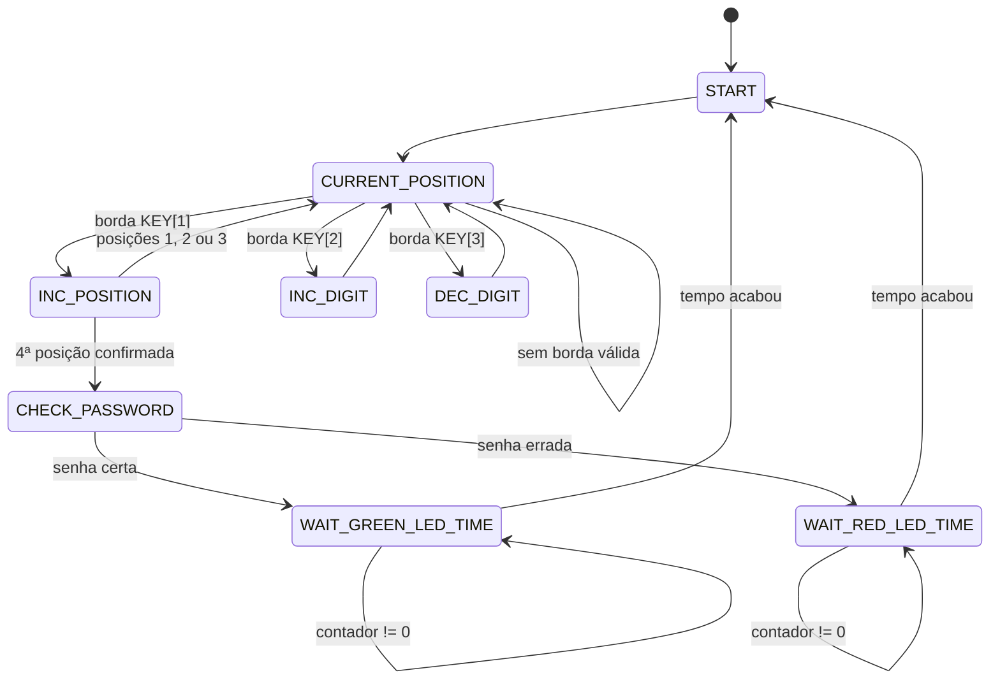
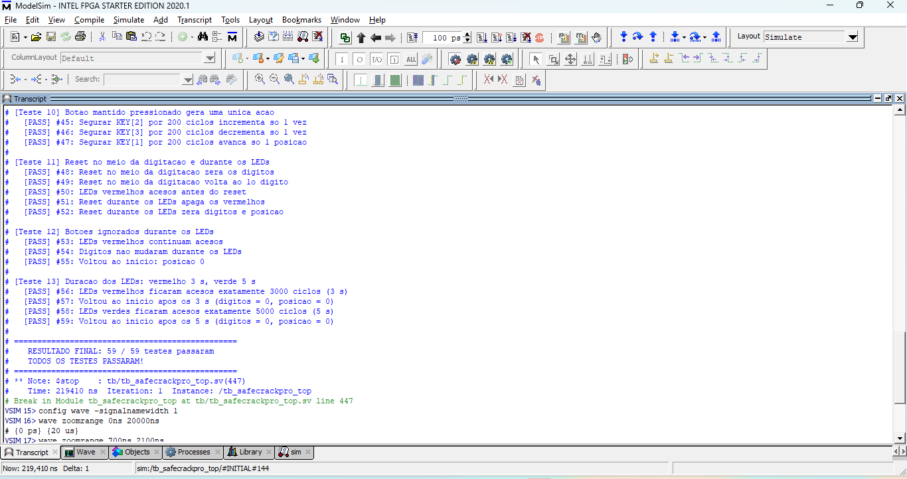
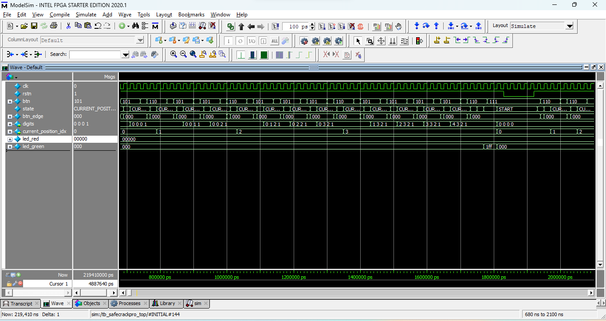
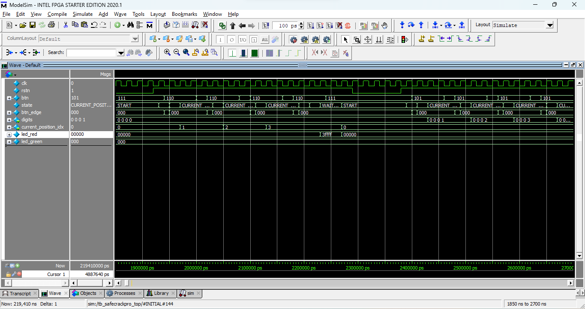
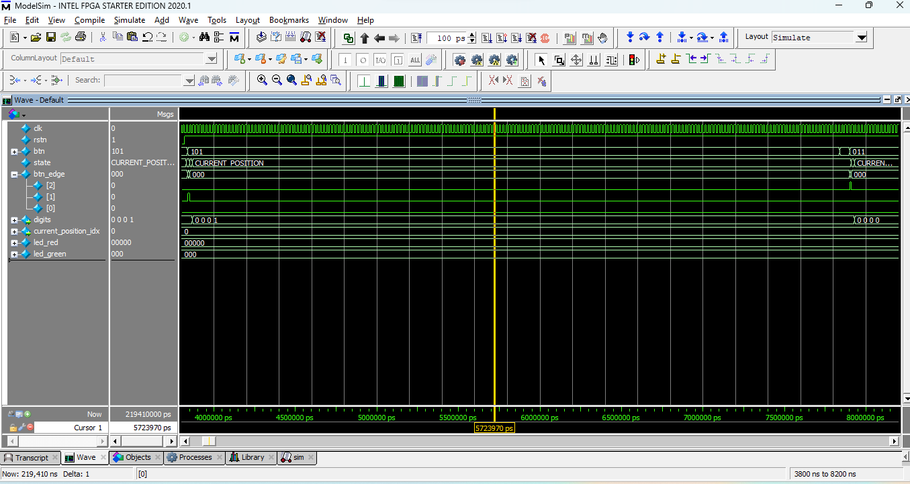

# SafeCrack Pro

Projeto final de **CIN0130 - Sistemas Digitais** (CIn/UFPE), feito em SystemVerilog para a placa **DE2-115**.

É um cofre digital de 4 dígitos. Em vez de digitar a senha de uma vez, o usuário monta cada dígito com os botões da placa: sobe ou desce o número, confirma e passa pro próximo. Os dígitos aparecem nos displays de 7 segmentos e, no final, os LEDs mostram se acertou (verde) ou errou (vermelho).

O projeto é uma evolução do `safecrack` que fizemos antes. Lá a senha era digitada direto; aqui ela é construída dígito a dígito.

## 1. Como usar

A senha padrão é **1-2-3-4**. Dá pra mudar nos parâmetros `PASS_D0` a `PASS_D3` do módulo `safecrackpro_fsm`.

Logo depois do reset, os quatro dígitos estão em 0 e o HEX4 mostra a posição 1. Você ajusta o dígito, confirma, e passa pra posição seguinte. Depois de confirmar o 4º dígito a senha é conferida. Não existe botão de voltar: se errar um dígito já confirmado, só resetando.

| Botão | Função |
|-------|--------|
| KEY[0] | reset assíncrono |
| KEY[1] | confirma o dígito e avança |
| KEY[2] | aumenta o dígito ativo |
| KEY[3] | diminui o dígito ativo |

Os botões da DE2-115 são ativos em nível baixo. O dígito dá a volta: 9 + 1 vira 0, e 0 - 1 vira 9.

| Display | Mostra |
|---------|--------|
| HEX3 | 1º dígito |
| HEX2 | 2º dígito |
| HEX1 | 3º dígito |
| HEX0 | 4º dígito |
| HEX4 | posição que está sendo editada (1 a 4) |

Resultado da tentativa:

- senha certa: os 9 LEDs verdes (`LEDG`) acendem por 5 segundos;
- senha errada: os 18 LEDs vermelhos (`LEDR`) acendem por 3 segundos.

Quando o tempo acaba, os dígitos voltam pra 0, a posição volta pra 1 e dá pra tentar de novo. O reset também funciona no meio da digitação e durante os LEDs.

A FSM só enxerga a **borda** do botão, então segurar um botão conta como um clique só. Pra repetir a ação, tem que soltar e apertar de novo.

## 2. Arquivos

```text
SafeCrackPro/
├── src/
│   ├── safecrackpro_top.sv
│   ├── safecrackpro_fsm.sv
│   ├── bcd_to_7segment_anodo.sv
│   ├── safecrack_pro.qpf          projeto do Quartus
│   ├── safecrack_pro.qsf          configurações e pinos
│   └── output_files/              relatórios e o .sof gerado
├── tb/
│   └── tb_safecrackpro_top.sv
├── quartus/
│   └── pin_assignments.txt
├── docs/                          prints da simulação
└── README.md
```

Pra abrir no Quartus, é só abrir o arquivo `src/safecrack_pro.qpf`. As pastas `db/` e `incremental_db/` foram removidas do zip porque o Quartus recria sozinho na primeira compilação.

## 3. Módulos

**`safecrackpro_top`** é o top-level. Instancia a FSM e cinco decodificadores de 7 segmentos (quatro pros dígitos e um pra posição ativa) e liga as saídas dos LEDs. O índice da posição vai de 0 a 3, então o top soma 1 antes de mandar pro HEX4, pra mostrar de 1 a 4.

**`bcd_to_7segment_anodo`** converte um valor de 4 bits no padrão dos displays de ânodo comum (segmento aceso em nível 0). Valores fora de 0 a 9 mostram um hífen.

**`safecrackpro_fsm`** é a máquina de estados e onde está quase toda a lógica: guarda os dígitos e a posição, detecta os cliques, confere a senha, conta o tempo dos LEDs e liga os LEDs de resultado.

| Parâmetro | Padrão | Descrição |
|-----------|--------|-----------|
| `CLK_FREQ_HZ` | 50_000_000 | clock da placa |
| `GREEN_SECS` | 5 | tempo do LED verde |
| `RED_SECS` | 3 | tempo do LED vermelho |
| `PASS_D0` a `PASS_D3` | 1, 2, 3, 4 | senha |

### 3.1 Estados

Usamos 8 estados em codificação one-hot:

| Estado | O que faz |
|--------|-----------|
| `START` | estado inicial (depois do reset ou dos LEDs), segue direto pra `CURRENT_POSITION` |
| `CURRENT_POSITION` | espera um botão |
| `INC_POSITION` | confirma o dígito e avança; se for o 4º, vai conferir a senha |
| `INC_DIGIT` | soma 1 no dígito ativo |
| `DEC_DIGIT` | subtrai 1 do dígito ativo |
| `CHECK_PASSWORD` | compara os 4 dígitos com a senha |
| `WAIT_RED_LED_TIME` | LEDs vermelhos acesos por 3 s |
| `WAIT_GREEN_LED_TIME` | LEDs verdes acesos por 5 s |

O reset assíncrono leva pra `START` de qualquer estado, por isso não desenhamos essa seta em todos.



### 3.2 Detecção de clique

Dentro da FSM os botões são invertidos pra trabalhar em nível alto. O valor anterior fica guardado em `btn_prev`, e o sinal `btn_edge` só vale 1 no ciclo em que o botão passa de solto pra apertado:

```systemverilog
btn_pos  = ~btn;
btn_edge = btn_pos & ~btn_prev;
```

No estado `CURRENT_POSITION`, a FSM só reage quando exatamente um dos três bits de `btn_edge` está ativo. Se dois botões forem apertados no mesmo ciclo, nada acontece. Nos estados `INC_DIGIT` e `DEC_DIGIT` só o dígito da posição ativa é alterado, então editar um dígito não mexe nos outros.

### 3.3 Tempo dos LEDs

```text
GREEN_CYCLES = GREEN_SECS * CLK_FREQ_HZ
RED_CYCLES   = RED_SECS   * CLK_FREQ_HZ
```

Com 50 MHz são 250 milhões de ciclos pro verde e 150 milhões pro vermelho. No `CHECK_PASSWORD` o contador é carregado com (ciclos - 1) e vai diminuindo no estado de espera. Quando chega em zero, a FSM zera os dígitos e volta pro `START`.

## 4. Pinos

Os pinos estão no `safecrack_pro.qsf` e também em `quartus/pin_assignments.txt`. FPGA: Cyclone IV E `EP4CE115F29C7`.

| Sinal | Placa |
|-------|-------|
| `clk` | CLOCK_50 |
| `rstn` | KEY[0] |
| `btn[0]`, `btn[1]`, `btn[2]` | KEY[1], KEY[2], KEY[3] |
| `seg_pos1` | HEX3 |
| `seg_pos2` | HEX2 |
| `seg_pos3` | HEX1 |
| `seg_pos4` | HEX0 |
| `seg_cur_pos` | HEX4 |
| `led_red[17:0]` | LEDR[17:0] |
| `led_green[8:0]` | LEDG[8:0] |

## 5. Compilação no Quartus

Compilado no Quartus Prime 21.1.1 Lite, com resultado `Successful` (0 erros). O relatório mostra:

| Recurso | Uso |
|---------|-----|
| Elementos lógicos | 150 de 114.480 (< 1%) |
| Registradores | 57 |
| Pinos | 67 de 529 (13%) |
| Memória, multiplicadores e PLLs | 0 |

O Quartus avisa que o pino `seg_cur_pos[5]` fica preso em GND. Isso é esperado e não é erro: esse bit é o segmento "b" do display, que fica sempre aceso (nível 0) nos dígitos 1, 2, 3 e 4, os únicos que o HEX4 mostra. O Quartus só otimiza o pino pra um valor fixo.

O arquivo pra gravar na placa é o `src/output_files/safecrack_pro.sof`.

## 6. Simulação

O testbench `tb/tb_safecrackpro_top.sv` gera um clock de 20 ns (50 MHz) e roda 13 grupos de teste, com 59 verificações no total. A tarefa `check` imprime `[PASS]` ou `[FAIL]` no Transcript:

1. reset inicial (dígitos, posição, LEDs e displays)
2. incremento do dígito
3. decremento do dígito
4. volta de 0 para 9 no decremento
5. volta de 9 para 0 no incremento
6. senha correta 1-2-3-4
7. senha errada
8. independência entre os dígitos
9. estabilidade sem apertar nenhum botão
10. botão segurado conta como uma ação só
11. reset no meio da digitação e durante os LEDs
12. botões ignorados enquanto os LEDs estão acesos
13. duração dos LEDs (3 s e 5 s)

Simular 250 milhões de ciclos seria inviável, então nos testes que checam o retorno ao início o testbench usa `force` pra zerar o contador interno. Já a duração real dos LEDs (teste 13) é medida com uma segunda instância da FSM configurada com `CLK_FREQ_HZ = 1000`, em que 1 "segundo" são 1000 ciclos. Os LEDs ficam acesos por 3000 e 5000 ciclos, como esperado.

### 6.1 Como rodar

Usamos o ModelSim - Intel FPGA Starter Edition 2020.1. Na pasta do projeto:

```text
vlib work
vlog -sv src/*.sv tb/tb_safecrackpro_top.sv
vsim -voptargs=+acc work.tb_safecrackpro_top
add wave sim:/tb_safecrackpro_top/clk
add wave sim:/tb_safecrackpro_top/rstn
add wave sim:/tb_safecrackpro_top/btn
add wave sim:/tb_safecrackpro_top/dut/fsm_inst/state
add wave sim:/tb_safecrackpro_top/dut/fsm_inst/btn_edge
add wave -radix unsigned sim:/tb_safecrackpro_top/dut/fsm_inst/digits
add wave -radix unsigned sim:/tb_safecrackpro_top/dut/fsm_inst/current_position_idx
add wave sim:/tb_safecrackpro_top/led_red
add wave sim:/tb_safecrackpro_top/led_green
run -all
```

Obs.: o testbench termina com `$stop`, então a simulação para sozinha no final e a Wave continua aberta.

### 6.2 Resultado

Todas as verificações passaram: **59 / 59**.



### 6.3 Senha correta (teste 6)

Janela de 680 ns a 2100 ns. O `digits` vai de `0000` até `4321` e a posição vai de 0 a 3. O ModelSim mostra o 4º dígito primeiro, então `4321` quer dizer 1º = 1, 2º = 2, 3º = 3 e 4º = 4. No final o `led_green` vai pra `1ff` (os 9 LEDs acesos) e depois o estado volta pra `START` com os dígitos zerados.



### 6.4 Senha errada (teste 7)

Janela de 1850 ns a 2700 ns. Os dígitos ficam em `0000`, a posição vai de 0 a 3 a cada confirmação em `btn` (`110`) e o `led_red` vai pra `3ffff` (os 18 LEDs acesos). Depois o estado passa por `WAIT_RED_LED_TIME` e volta pra `START`. Ainda nesse print dá pra ver o começo do teste 8, com o `digits` subindo.



### 6.5 Botão segurado (teste 10)

Janela de 3800 ns a 8200 ns, com o `btn` em `101` (KEY[2] apertado) por 200 ciclos, cerca de 4 µs. Nesse tempo o `btn_edge[1]` dá um único pulso, logo no começo, e o `digits` vai pra `0001` uma vez só e fica parado, mesmo com o botão continuando apertado. No final do trecho, o `btn` vira `011` (KEY[3]) e o dígito volta pra `0000`, também uma vez só.



## 7. Teste na placa

Também gravamos o projeto na DE2-115 e testamos fisicamente. O arquivo usado foi o `src/output_files/safecrack_pro.sof`.

## 8. Limitações

São coisas que notamos lendo o código:

- **Sem debounce.** Detectamos a borda do botão, mas não há circuito pra filtrar a trepidação mecânica. Em teoria, um ruído poderia contar como um clique novo.
- **Botões simultâneos.** Se dois botões forem apertados no mesmo ciclo, a FSM ignora os dois.
- **Sem voltar.** Depois de confirmar um dígito, só o reset permite corrigir.

---

CIN0130 - Sistemas Digitais · DE2-115 · SystemVerilog
