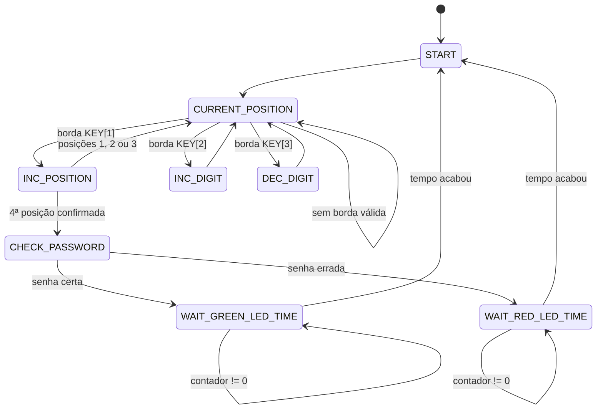

# SafeCrack Pro

Projeto da disciplina **CIN0130 - Sistemas Digitais** (CIn/UFPE, 2026.2).

Cofre digital de 4 dígitos em SystemVerilog para a placa **DE2-115**, onde o usuário monta a senha um dígito por vez com os botões da placa. A verificação ocorre em uma máquina de estados finita (FSM) e os LEDs mostram se acertou (verde) ou errou (vermelho).

## Vídeo

[Assista ao vídeo do projeto no YouTube](https://youtu.be/ctupQF1Bq1I?is=0mXp30WWpVVDlVs-)

## Estrutura do repositório

```text
.
├── src/
│   ├── safecrackpro_top.sv         # top-level: liga a FSM aos displays e LEDs
│   ├── safecrackpro_fsm.sv         # FSM: dígitos, posição, senha e tempo dos LEDs
│   ├── bcd_to_7segment_anodo.sv    # decodificador de 4 bits para 7 segmentos
│   ├── safecrack_pro.qpf / .qsf    # projeto do Quartus e pinagem
│   └── output_files/               # relatórios e .sof gerado
├── tb/tb_safecrackpro_top.sv       # testbench
├── docs/                           # prints da simulação
└── README.md
```

Para abrir no Quartus, use `src/safecrack_pro.qpf`.

## Como usar

A senha padrão é **1-2-3-4** (parâmetros `PASS_D0` a `PASS_D3` da FSM). Após o reset, os quatro dígitos mostram 0 e o HEX4 mostra a posição 1. Ajuste o dígito, confirme e avance; ao confirmar o 4º, a senha é conferida.

| Botão | Função |
|-------|--------|
| KEY[0] | reset assíncrono |
| KEY[1] | confirma o dígito e avança |
| KEY[2] | incrementa o dígito ativo (9 → 0) |
| KEY[3] | decrementa o dígito ativo (0 → 9) |

| Display | Mostra |
|---------|--------|
| HEX3, HEX2, HEX1, HEX0 | 1º, 2º, 3º e 4º dígitos |
| HEX4 | posição em edição (1 a 4) |

- **Senha correta:** os 9 LEDs verdes (`LEDG`) acendem por 5 s.
- **Senha incorreta:** os 18 LEDs vermelhos (`LEDR`) acendem por 3 s.
- Depois disso, os dígitos voltam a 0 e a posição volta a 1.
- Não há retorno a um dígito confirmado; para corrigir, use o reset (que funciona em qualquer momento).
- Segurar um botão conta como um único clique.

## Requisitos e implementação

| Requisito | Implementação |
|-----------|---------------|
| Senha de 4 dígitos (0 a 9), definida no código | Parâmetros `PASS_D0` a `PASS_D3`; dígitos guardados em `digits` (4 bits cada) |
| Dígitos em HEX3 a HEX0 | `digits[0]` no HEX3 até `digits[3]` no HEX0, cada um com um `bcd_to_7segment_anodo` |
| Dígito ativo no HEX4 | `current_position_idx` (0 a 3) somado a 1 no top |
| Após o reset, tudo em 0 e 1º dígito ativo | Reset assíncrono leva a `START` e zera `digits` e a posição |
| KEY[2] incrementa, KEY[3] decrementa, com wrap-around | Estados `INC_DIGIT` e `DEC_DIGIT` (9 → 0 e 0 → 9) |
| KEY[1] confirma e avança; no 4º confere a senha | `INC_POSITION`; na posição 3 segue para `CHECK_PASSWORD` |
| Sem retorno a dígito confirmado | Só `INC_POSITION` altera a posição, sempre para frente |
| Um clique = uma ação | `btn_edge` detecta só a passagem de solto para pressionado |
| Senha certa: LEDs verdes por 5 s | `WAIT_GREEN_LED_TIME`, contador de `GREEN_SECS * CLK_FREQ_HZ` ciclos |
| Senha errada: LEDs vermelhos por 3 s | `WAIT_RED_LED_TIME`, contador de `RED_SECS * CLK_FREQ_HZ` ciclos |
| Fim dos LEDs: volta ao início | A FSM zera `digits` e a posição e vai para `START` |

Parâmetros da FSM: `CLK_FREQ_HZ` (50 MHz), `GREEN_SECS` (5), `RED_SECS` (3) e `PASS_D0` a `PASS_D3` (1, 2, 3, 4).

## Módulos

**`safecrackpro_top`** é o top-level. Instancia a FSM e cinco decodificadores de 7 segmentos (quatro para os dígitos e um para a posição ativa) e liga as saídas dos LEDs. O índice da posição vai de 0 a 3, então o top soma 1 antes de mandar pro HEX4, para mostrar de 1 a 4.

**`bcd_to_7segment_anodo`** converte um valor de 4 bits no padrão dos displays de ânodo comum (segmento aceso em nível 0). Valores fora de 0 a 9 mostram um hífen.

**`safecrackpro_fsm`** é a máquina de estados e onde está quase toda a lógica: guarda os dígitos e a posição, detecta os cliques, confere a senha, conta o tempo dos LEDs e liga os LEDs de resultado.

| Parâmetro | Padrão | Descrição |
|-----------|--------|-----------|
| `CLK_FREQ_HZ` | 50_000_000 | clock da placa |
| `GREEN_SECS` | 5 | tempo do LED verde |
| `RED_SECS` | 3 | tempo do LED vermelho |
| `PASS_D0` a `PASS_D3` | 1, 2, 3, 4 | senha |

### 4.1 Estados

8 estados em codificação one-hot:

| Estado | O que faz |
|--------|-----------|
| `START` | estado inicial (depois do reset ou dos LEDs), segue direto pra `CURRENT_POSITION` |
| `CURRENT_POSITION` | espera um botão |
| `INC_POSITION` | confirma o dígito e avança; se for o 4º, confere a senha |
| `INC_DIGIT` | soma 1 no dígito ativo |
| `DEC_DIGIT` | subtrai 1 do dígito ativo |
| `CHECK_PASSWORD` | compara os 4 dígitos com a senha |
| `WAIT_RED_LED_TIME` | LEDs vermelhos acesos por 3 s |
| `WAIT_GREEN_LED_TIME` | LEDs verdes acesos por 5 s |

O reset assíncrono leva pra `START` de qualquer estado, por isso a seta não está em todos.



**Detecção de clique:**

Os botões (ativos em nível baixo) são invertidos, e o valor anterior fica em `btn_prev`. O sinal `btn_edge` vale 1 só no ciclo em que o botão passa de solto para pressionado:

```systemverilog
btn_pos  = ~btn;
btn_edge = btn_pos & ~btn_prev;
```

Em `CURRENT_POSITION`, a FSM só reage se exatamente um bit de `btn_edge` estiver ativo. Dois botões no mesmo ciclo são ignorados.

**Tempo dos LEDs:**

```text
GREEN_CYCLES = GREEN_SECS * CLK_FREQ_HZ
RED_CYCLES   = RED_SECS   * CLK_FREQ_HZ
```

Com 50 MHz, são 250 milhões de ciclos para o verde e 150 milhões para o vermelho. Em `CHECK_PASSWORD` o contador é carregado com (ciclos - 1) e decrementa no estado de espera. Ao chegar a zero, a FSM volta a `START`.

## Pinos

Pinagem em `src/safecrack_pro.qsf` (Cyclone IV E `EP4CE115F29C7`):

| Sinal | Placa |
|-------|-------|
| `clk` | CLOCK_50 |
| `rstn` | KEY[0] |
| `btn[0]`, `btn[1]`, `btn[2]` | KEY[1], KEY[2], KEY[3] |
| `seg_pos1` | HEX3 |
| `seg_pos2` | HEX2 |
| `seg_pos3` | HEX1 |
| `seg_pos4` | HEX0 |
| `seg_cur_pos` | HEX4 |
| `led_red[17:0]` | LEDR[17:0] |
| `led_green[8:0]` | LEDG[8:0] |

## Compilação no Quartus

Compilado no Quartus Prime 21.1.1 Lite, com resultado `Successful` (0 erros). O `src/output_files/safecrack_pro.flow.rpt` mostra:

| Recurso | Uso |
|---------|-----|
| Elementos lógicos | 150 de 114.480 (< 1%) |
| Registradores | 57 |
| Pinos | 67 de 529 (13%) |
| Memória, multiplicadores e PLLs | 0 |

O aviso de `seg_cur_pos[5]` preso em GND é esperado: é o segmento "b", sempre aceso nos dígitos 1 a 4, os únicos exibidos no HEX4. O arquivo de gravação é `src/output_files/safecrack_pro.sof`.

## Simulação

O testbench gera clock de 50 MHz e executa 13 grupos de teste (59 verificações): reset, incremento, decremento, wrap-around (0 → 9 e 9 → 0), senha correta, senha errada, independência dos dígitos, estabilidade sem botões, botão segurado, reset durante a digitação e durante os LEDs, botões ignorados durante os LEDs e duração dos LEDs.

Simular 250 milhões de ciclos é inviável, então os testes que checam o retorno ao início usam `force` para zerar o contador. A duração real (3 s e 5 s) é verificada no teste 13, com uma segunda instância da FSM em `CLK_FREQ_HZ = 1000`, em que 1 "segundo" equivale a 1000 ciclos: os LEDs ficam acesos por 3000 e 5000 ciclos.

Para executar no ModelSim - Intel FPGA Starter Edition 2020.1, na raiz do projeto:

```text
vlib work
vlog -sv src/*.sv tb/tb_safecrackpro_top.sv
vsim -voptargs=+acc work.tb_safecrackpro_top
add wave sim:/tb_safecrackpro_top/clk
add wave sim:/tb_safecrackpro_top/rstn
add wave sim:/tb_safecrackpro_top/btn
add wave sim:/tb_safecrackpro_top/dut/fsm_inst/state
add wave sim:/tb_safecrackpro_top/dut/fsm_inst/btn_edge
add wave -radix unsigned sim:/tb_safecrackpro_top/dut/fsm_inst/digits
add wave -radix unsigned sim:/tb_safecrackpro_top/dut/fsm_inst/current_position_idx
add wave sim:/tb_safecrackpro_top/led_red
add wave sim:/tb_safecrackpro_top/led_green
run -all
```

O testbench termina com `$stop`, e a Wave continua aberta.

**Resultado:** 59 / 59 verificações passaram.


### Formas de onda

Nas duas primeiras janelas, o tempo dos LEDs aparece reduzido porque o testbench pula a espera com `force`. Os pulsos em `rstn` são resets aplicados entre os testes.

**Senha correta (teste 6), 680 ns a 2100 ns.** `digits` vai de `0000` a `4321` e a posição de 0 a 3. O ModelSim mostra o 4º dígito à esquerda, então `4321` significa 1º = 1, 2º = 2, 3º = 3 e 4º = 4. Em seguida `led_green` vai a `1ff` (9 LEDs) e o estado volta a `START` com os dígitos zerados.


**Senha errada (teste 7), 1850 ns a 2700 ns.** Os dígitos ficam em `0000`, e a posição avança a cada confirmação (`btn = 110`). Depois `led_red` vai a `3ffff` (18 LEDs), o estado passa por `WAIT_RED_LED_TIME` e volta a `START`. No fim da janela começa o teste 8, com `digits` subindo.


**Botão segurado (teste 10), 3800 ns a 8200 ns.** Com `btn = 101` (KEY[2]) por 200 ciclos (cerca de 4 µs), `btn_edge[1]` dá um único pulso e `digits` vai a `0001` uma só vez. No fim, `btn = 011` (KEY[3]) faz o dígito voltar a `0000`, também uma só vez.


## Teste na placa

O projeto foi gravado na DE2-115 com o arquivo `src/output_files/safecrack_pro.sof`. No vídeo, ocorre o teste da senha correta (1-2-3-4, LEDs verdes), uma senha incorreta (2-3-4-1, LEDs vermelhos).

## 9. Limitações (known issues)

- **Botões simultâneos.** Se dois botões forem pressionados no mesmo ciclo, a FSM ignora ambos.
- **Sem retorno a dígito confirmado.** Segue a especificação, a correção é feita pelo reset.
---

CIN0130 - Sistemas Digitais · DE2-115 · SystemVerilog
